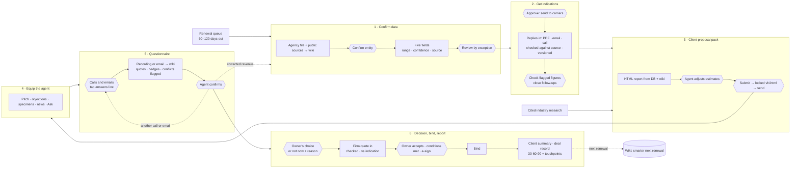

# Interview notes — Cyber in the Renewal Window

Randy Hesse · UKON final round (Matt Hightower, David, executive team, engineering) · prepared Oct 26, 2026 · updated Oct 27 for the six-stage redesign

These notes cover the whole project: what was built, why, the use cases, the conversations it
supports, the workflows behind it, a demo talk track, and prep for the Q&A. Deeper detail lives in
the other `docs/` files; each section points to them.

---

## Contents

1. [The 60-second version](#1-the-60-second-version)
2. [The problem and the people](#2-the-problem-and-the-people)
3. [Principles behind the design](#3-principles-behind-the-design)
4. [The end-to-end flow](#4-the-end-to-end-flow)
5. [What was built](#5-what-was-built)
6. [Use cases](#6-use-cases)
7. [Conversation flows](#7-conversation-flows)
8. [Workflows and state machines](#8-workflows-and-state-machines)
9. [Where AI helps, and where it doesn't](#9-where-ai-helps-and-where-it-doesnt)
10. [Key decisions and trade-offs](#10-key-decisions-and-trade-offs)
11. [Measuring success](#11-measuring-success)
12. [Risks and how they're caught](#12-risks-and-how-theyre-caught)
13. [What's real, what's fictional, known gaps](#13-whats-real-whats-fictional-known-gaps)
14. [Demo talk track (30 minutes)](#14-demo-talk-track-30-minutes)
15. [Q&A prep](#15-qa-prep)
16. [Interview plan (draft)](#16-interview-plan-draft)
17. [Working with engineering](#17-working-with-engineering)
18. [How AI was used to build this](#18-how-ai-was-used-to-build-this)
19. [Running it](#19-running-it)
20. [File map](#20-file-map)

---

## 1. The 60-second version

Most small businesses an independent agency insures have no cyber coverage, and most agents never
raise it. The best moment is the renewal window, but getting a client from "no cyber" to
"protected" is too much manual work, so the moment gets missed.

The prototype takes one real client, **Sloan's Lake Dental** (Sage Dentistry, PLLC; three dentists,
Denver CO; public data only, with a simulated renewal on Jan 15, 2027) through six stages. UKON's
brief has four; I split its Stage 1 in two, because confirming the data and the round trip with
carriers have different owners and a person's approval belongs between them, and its Stage 4 in two,
because the questionnaire takes several touches and is where deals stall.

1. **Confirm data:** the five fields carriers need, mostly from the agency's own file at renewal,
   filled from public records with confidence and sources; a person reviews only what's uncertain
   and always confirms the company.
2. **Get indications:** a person approves "Send to carriers" (blocked until Stage 1 is reviewed).
   Replies come back as PDFs, emails or underwriter calls; AI reads them, every figure is checked
   against the source, and each reply adds a version. Fixed rules turn changes into follow-ups.
3. **Client proposal pack:** an HTML report for a non-technical owner: price first, their own
   answers so far, real recent incidents in their industry, plain-language coverage. Agents adjust
   estimates; carrier prices are locked. Every version is saved.
4. **Equip the agent:** pitch, objection answers from an approved library, talking points, policy
   form map, and an "Ask about this client" assistant that never interprets coverage.
5. **Questionnaire:** the application questions over as many calls and emails as it takes; the agent
   taps answers while Wispr Flow records, and the recording is checked against the taps. Filter to
   what's not answered. **Missing answers never block the pack.**
6. **Decision, bind, report:** the owner's choice (or "not now" and why); the carrier's firm quote,
   checked and compared with the indication; the owner's yes; conditions met with evidence; bind
   (simulated); a client summary, a deal record, and a 30-60-90 plan with touchpoints to renewal.

The rule underneath all of it: **the database owns the numbers; the wiki owns the evidence.** AI
reads, extracts, explains and writes prose. It never writes a price, limit, or any figure a client
sees.

---

## 2. The problem and the people

**The goal (UKON's words):** get many more of an agency's clients quoted and bound for cyber during
their renewal window, with as little extra work for the agent as possible.

| Who | What they need | What gets in their way today |
|---|---|---|
| **Agent** (producer, account manager) | Offer cyber without a research project; look credible; not lose the relationship | Hand-collecting five data fields; explaining a product they don't know deeply; small premium = small commission for the effort |
| **Business owner** | Know what it costs, whether it's real for *them*, what they get | Jargon, long forms, "we're too small to be a target," "my IT guy handles it" |
| **Cyber Practice Leader (CPL)**, UKON | Support many agencies; protect coverage accuracy | Fielding every question; agents guessing at coverage |
| **UKON ops / wholesale** | Clean submissions to carriers | Incomplete or wrong data, wrong entity |
| **Carriers** | Accurate applications; controls like MFA | Misrepresentation on applications |

**Framing for the panel:** this is a throughput problem disguised as a sales problem. The north-star
metric is **agent minutes per bound policy** (section 11).

---

## 3. Principles behind the design

1. **The database owns the numbers; the wiki owns the evidence.** Postgres holds every value,
   version and change; the wiki (Obsidian) holds sources, reasoning and industry knowledge.
2. **Humans decide; AI does the paperwork.** People confirm the entity match, flagged estimates,
   sending to carriers, any carrier figure that failed the source check, call answers, and sending
   the pack. The client signs the application.
3. **Review by exception.** High-confidence fields pass; only uncertain ones need a person.
4. **Incomplete never blocks.** Open answers show as "to confirm"; the pack still goes out.
5. **Never silently resolve a disagreement.** Conflicting sources, recording-vs-tap conflicts and
   changed answers are flagged for a person.
6. **Lock what isn't ours to change.** Carrier premiums, limits and deductibles can't be edited, and
   every carrier reply adds a version instead of overwriting the last.
7. **Escalate coverage questions.** Neither the AI nor the agent answers "would this be covered?"
8. **Everything is auditable.** Who changed what, when, why; versions are immutable once submitted.
9. **Knowledge compounds.** Renewals repeat yearly, and industry pages are shared across every
   client in that industry, so each year starts ahead of the last.

---

## 4. The end-to-end flow



How the six stages map to UKON's four (decisions #55, #59, #60):

| # | Stage | UKON stage | In the prototype |
|---|---|---|---|
| 1 | Confirm data | 1 (part 1) | **Enrich** (+ entity resolution, review by exception): the five fields only |
| 2 | Get indications | 1 (part 2) | **Send to carriers** (gated on Stage 1) → replies in, versioned, checked → follow-ups |
| 3 | Client proposal pack | 2 | **Client pack** (HTML), estimates and benchmarks behind it |
| 4 | Equip the agent | 3 | **Agent brief** + **Ask about this client** |
| 5 | Questionnaire | 4 (part 1) | **Calls and emails** (live taps + Wispr Flow recording) → answers with quotes → **Application** |
| 6 | Decision, bind, report | 4 (part 2) | **Owner's choice** → **firm quote** vs indication → yes → conditions → **bind** (simulated) → reports + 30-60-90 |

Why split Stage 1: confirming five facts and the carrier round trip have different owners and failure
modes, and a person's approval belongs between them, before client data leaves the agency. The detailed
security questions moved after the pack: asking them before the owner has seen a price adds friction. Why split
Stage 4: the questionnaire usually takes several calls and emails and doesn't depend on which carrier wins, so
it gets its own stage; the owner's choice opens Stage 6. The demo seed runs call 1 early so the pack shows what the
owner has said so far, then call 2 and the office manager's email.

---

## 5. What was built

A working local app. One project folder: uv for Python, with Postgres and Node bundled inside it,
no Docker and nothing installed system-wide.

| Layer | What it is | Where |
|---|---|---|
| **Knowledge (wiki)** | Obsidian vault in the LLM-wiki pattern: raw sources, generated client and intake pages, shared industry page, research, schema | `wiki/` |
| **System of record** | Postgres: fields with AI value vs current value, field-change log, indication requests / replies / versions (values locked by trigger) / follow-ups, immutable report versions, call and email answers, application answers, CPL questions, owner's decisions, firm quotes (locked), bind conditions, binders, ask log, audit view | `db/schema.sql` |
| **Pipeline** | The six stages and their derived status (`stages.py`), deterministic estimators (no LLM), entity resolution, carrier exchange (requests, reply extraction with a source check, versions, rule-based follow-ups), narrative with a no-digits guard, call/email extraction and merge, firm quote + bind + after-bind plan (`bind.py`), HTML report export | `pipeline/` |
| **API** | FastAPI; read-only "Ask" with tool use; serves the built front end | `api/` |
| **Workbench** | React app, one tab per stage with a status: 1 Confirm data · 2 Get indications · 3 Proposal pack · 4 Equip the agent · 5 Questionnaire (Live call / After the call / Application, filter + collapsible sections) · 6 Decision, bind, report · Audit · Ask | `web/` |
| **Client pack** | Standalone HTML file per version | `reports/sloanslake/` |
| **Claude skills** | `client-ingest`, `indication-ingest` (carrier replies), `call-ingest` (Wispr Flow), `client-research` (web), `client-ask` | `.claude/skills/` |
| **Docs** | Brief, decisions (60), workflow, call script, pack outline, scope, risks, architecture, chat log, these notes | `docs/` |

**The demo client in numbers (all from the database):**
- Legal name **Sage Dentistry, PLLC** (Colorado registry, good standing since 2015; the NPI record ties it to the "Sloan's Lake Dental" trade name). A delinquent "Sloans Lake Dental PLLC" sits at the same address: 37% vs 100%.
- Employees **12** estimated (range 9–15, low confidence): nothing public; 3 dentists on the team page × ~4 support staff (an assumption, flagged)
- Revenue **$2,350,000** estimated (range $1.65M–$3.2M, low confidence): 12 staff × $152,600 = $1,831,200 and 3 dentists × $965,660 = $2,896,980. They disagree by ~$1.1M. On the (simulated) call the owner says it's higher and defers to the accountant; the office manager's (simulated) email then gives **$2,520,000** from the accountant.
- Exposure **68/100 → 63 after call 1 → 45 after call 2**; the starting score uses the practice's real DNS (Paubox email, SPF -all, no DMARC) and real online bill pay (Adit)
- Indications: three fictional carriers calibrated to real 2026 benchmarks, two options each ($1M/$10K, $2M/$25K). Default by rule: Northwind **$2,980 a year ($248 a month)** for $1M, social-engineering sublimit $100K, ransomware to the full limit (Ridgeline is cheaper at $2,590 but caps ransomware at $500K and declines $2M). Northwind's revised letter, read in live, moves both premiums up 10% ($3,280 / $5,190) and adds an EDR condition. Cobalt's $2M figure ($5,290, written "5.29k") waits for a person.
- Firm quote (fictional, Stage 6): Northwind $1M / $10K **$3,410** (+14% vs the $2,980 indication), with the carrier's stated reason: revenue $2.52M, no phishing training, backups never restore-tested. Two conditions before binding (MFA on email, a restore test), one within 60 days (phishing training).

---

## 6. Use cases

Each use case: who, trigger, what happens, outcome, guardrail. ✅ = built, ◻ = designed, not built.

### UC1 · Spot the renewal ◻
- **Actor:** agent / account manager · **Trigger:** policies renewing in 60–120 days
- **Flow:** pull renewals from the agency system; rank by fit; skip clients already covered by a cyber endorsement
- **Outcome:** a prioritized queue (the "how this scales" slide)
- **Guardrail:** existing-coverage check before any work starts

### UC2 · Stage 1 · Resolve the entity ✅
- **Actor:** pipeline + reviewer (agent, CPL or ops) · **Trigger:** client enters the queue
- **Flow:** ingest agency record, state registry, NPI registry, website, directory listings, DNS → score entity
  candidates on name, state, address, domain and registry status → **person confirms** the match
- **Demo moment:** the real registry has "Sloans Lake Dental PLLC" at the same address, delinquent since 2022: 37% vs the right entity at 100%
- **Guardrail:** name similarity alone is never enough; confirmation is always human

### UC3 · Stage 1 · Confirm the five fields by exception ✅
- **Flow:** legal name, domain, industry, revenue, address, each with value, range, confidence,
  method, sources; only low-confidence or estimated items are flagged. Gaps go back to the client
  (usually domain or this year's revenue), not the whole list.
- **Outcome:** reviewer approves or edits; every edit records where the value came from
  (conversation, clipboard, API, typed) and who made it
- **Guardrail:** estimates show method and range, never a bare number

### UC4 · Stage 2 · Send to carriers ✅ (carriers simulated)
- **Flow:** the screen shows exactly what will go out and each field's review state → agent picks
  carriers → **Send**. Refused until the entity is confirmed and the five fields are reviewed.
  The basis is stored per request, so you can always see what a carrier priced on.
- **Demo:** the seed's first requests went out before review (labelled "demo seed"); the re-request is gated
- **Guardrail:** a person approves before client data leaves the agency

### UC5 · Stage 2 · Read in a carrier reply ✅
- **Flow:** reply lands in the carrier inbox (PDF letter, email, underwriter call via Wispr Flow) →
  "Read it in" → AI extracts → every figure checked against the source text → new version per
  carrier + option, with a diff → follow-ups by fixed rules (price changed, new condition checked
  against the client's answers, declined, get it in writing)
- **Demo:** Northwind's revised letter: both premiums +10%, a new EDR condition; the pack updates itself
- **Guardrails:** values locked by a database trigger; a figure not found word for word waits for a
  person ("Matches the source" / "Doesn't match"); verbal figures are stored but never client-facing;
  revenue drift beyond ±15% from the carrier's basis raises "re-request"

### UC6 · Stage 5 · Run the live call ✅
- **Actor:** agent, on the phone with the owner · **Screen:** Stage 5 (Questionnaire) → Live call
- **Flow:** open with recording consent → confirm identity items (prefilled from Stage 1, with
  confidence) → application questions read by number, answers tapped → "Client unsure" on hedges →
  log coverage questions for a CPL → limit walkthrough with the client's own answers filled in
- **Outcome:** taps saved to the database as the agent goes. Answers already on record (an earlier call or
  email) show as answered with their source; **Correct** opens the inputs. Filter to "not answered" on a
  follow-up call; sections collapse.
- **Guardrails:** figures in the walkthrough come from the database or show "not modelled yet";
  the agent never estimates a number on the call

### UC7 · Stage 5 · Ingest the recording or an email and reconcile; follow-ups ✅
- **Actor:** agent or Claude (`call-ingest` skill) · **Trigger:** a call ends or the client emails answers
- **Flow:** Wispr Flow transcript → saved to the wiki → AI extracts call + application answers,
  each with a quote and timestamp → hedge check → compare with live taps → merge across calls
- **Outcome:** each item is "Recorded · confirm," "Needs follow-up," or a **CONFLICT** (recording ≠ tap)
- **Demo:** call 2 (office manager) confirms MFA for everyone and EDR on all nine computers;
  backups stay untested; exposure 63 → 45; the HTML pack updates itself. The office manager's email
  gives revenue ($2.52M per the accountant), encryption, no California patients, and "I think the limit is
  $50,000" on a breach endorsement: flagged, and the "already covered" belief in the client's own words
- **Guardrails:** hedged "yes" is never a yes; conflicts are never auto-resolved; an older call
  re-ingested never overwrites a newer one; a contradiction of a confirmed answer reopens it

### UC8 · Coverage question during a call ✅
- **Flow:** the owner asks "Would a breach that starts at our IT company be covered?" → the agent
  says the scripted line → the question is logged (live) or detected in the recording → CPL list
- **Guardrail:** never answered by the agent or the AI

### UC9 · Stage 3 · Build the client pack with incomplete answers ✅
- **Flow:** HTML report built from DB + indications + answers so far + research + approved coverage
  text; open items show as "to confirm"
- **Outcome:** `reports/sloanslake/current.html`, rewritten on every change
- **Guardrail:** AI prose with any digit is rejected; figures come only from the database

### UC10 · Stage 3 · Adjust estimates; catch stale prices ✅
- **Flow:** agent moves revenue / employees / exposure / records sliders with a reason
- **Demo:** revenue → $2.8M (+19% vs the $2.35M carriers priced on) → "indication needs refresh" banner; premiums do **not** move
- **Guardrail:** tolerance ±15% from what the carrier priced on

### UC11 · Stage 3 · Submit, lock, send; versioning ✅
- **Flow:** submit → `v1.html` written and frozen → send → client view shows only that → any later
  change creates v2; v1 stays as sent. **Undo submit** (before sending): v1 is marked withdrawn with who,
  when and why, the version it superseded comes back, and editing continues in v2. A **Locked versions**
  dropdown opens any submitted, sent, superseded or withdrawn version read-only.
- **Guardrail:** immutable versions (undo withdraws, never unlocks); a sent version can't be withdrawn;
  the client never sees a draft

### UC12 · Stage 4 · Prepare for the meeting (agent brief) ✅
- 60-second pitch, objections with tailored answers from a CPL-approved library, escalation
  triggers, specimen "where to find it" map, application preview, real-event talking points

### UC13a · Stage 4 · Ask the wiki (chat) ✅
- **Flow:** the agent chats with Claude on the Equip-the-agent screen. Claude searches and reads the client wiki
  first (sources, call answers, carrier replies, industry page, research; numbers from the database). Only if the
  wiki doesn't cover it, and "Wiki first, then web" is on, does it search the web.
- **Outcome:** every answer carries a label set by the tools that actually ran: *From the wiki*, *From the web*,
  *Wiki + web*, or *Not from the wiki · unverified*; wiki pages open from the answer, web results link out
- **Guardrails:** wiki-specific questions get wiki-only answers; "Wiki only" mode doesn't offer the web tool at
  all; coverage questions escalate; read-only; logged to `ask_log`

### UC13 · Ask about this client ✅
- **Flow:** agent asks in plain English → numbers from the database, reasons from the wiki, cited
- **Guardrails:** read-only (changes go through sliders); coverage questions escalate

### UC14 · Refresh industry research ✅ (skill)
- **Flow:** `client-research` skill searches for recent real events (ransomware, breaches, vendor
  incidents, regulation) → cited items in the wiki → pack and brief update
- **Guardrails:** no URL, no item; figures quoted from the source; a person skims before sending

### UC15 · Stage 6 · Owner's choice, firm quote, bind ✅ (carrier side simulated)
- **Actor:** agent · **Screen:** Stage 6 (Decision, bind, report)
- **Flow:** record the owner's choice, or "not now" with a reason (price, already covered, no need,
  carrier requirements, timing, other) → take in the carrier's firm quote (every figure and date checked
  against the PDF; compared with the indication; conditions tagged before / after binding) → owner
  accepts or declines with a reason → mark each before-binding condition met with evidence → bind
- **Demo:** Northwind $2,980 → $3,410 (+14%) with the carrier's reason quoted; phishing training is a new
  60-day condition; bind gives a simulated policy number
- **Guardrails:** the choice locks once a quote is in; Bind stays off (and says why) until the quote is
  checked, the owner said yes, conditions are met and every application answer is confirmed; e-signature
  and the carrier's binder are simulated

### UC15b · Stage 6 · Reports and the year after bind ✅
- **Client summary:** what they bought in plain words, what to do if something happens, what they agreed
  to keep in place; "would this be covered?" goes to a CPL
- **Deal record (agency + UKON):** outcome (bound, or lost with the reason), milestones, who did what,
  sources behind every number
- **After bind:** 30-60-90 (welcome call, carrier onboarding, condition check and deadline, weak-spot
  follow-ups like DMARC, first quarterly check-in) and touchpoints to renewal (mid-year, then 120 / 90 /
  60 / 30 days out), built by rules; owners are proposed, because who owns them at UKON is an open question

### UC16 · Compliance and audit review ✅
- **Flow:** Audit tab: every human action with actor, role, time and reason; overrides double as
  training signal ("where people keep overriding the AI is where the estimators need work")

### UC17 · Browse the knowledge (Obsidian) ✅
- Open `wiki/` as a vault: client, indications and call-answer pages (generated), industry page, every raw
  source, clickable citations, graph view. **Next year's renewal starts here.**

### UC18 · Next renewal, next client in the same industry ◻ (by design)
- Industry page, objection library and research carry over; only what changed is re-ingested.

---

## 7. Conversation flows

### 7.1 Stage 5 call (agent ↔ owner), call 1
Source: `wiki/raw/sloanslake/call_1_intake.md` · script: `docs/client-intake.md`

```
Opening       Agent: recording disclosure → Owner: "Sure, that's fine."      ← consent captured
Identity      Agent reads each prefilled item → Owner confirms or corrects
              "It's higher than that, I'm pretty sure … I'd want our
               accountant to give you the real number."                      ← revenue stays open
Exposure      Agent: "Question 2 …"  (says the number aloud so the recording lines up)
              Owner: "I'd say eighty, eighty-five percent stops."            → Over 75%
              Owner: "Mostly. I do, and the front desk does. Not sure about
                      the hygienists."                                        → MFA flagged (hedge)
              Owner: "I believe Peak Tech installed something last year."   → EDR flagged (hedge)
              Owner: "Our office manager always calls."                       → payment check in place
Walkthrough   Agent reads how each limit figure is built, with the owner's
              own answers filled in; checks: "Does that record count sound right?"
              Owner: "Yes, twelve thousand is about right."
Coverage Q    Owner: "Would a breach that starts at Peak Tech be covered?"
              Agent: "Good question. I'll get a coverage specialist to confirm that in writing."
              → logged for a CPL
Closing       Agent: next steps; the application will come from what was just covered
```

**Branches the screen supports:** client corrects a prefilled value (type the correction) · client
hedges ("Client unsure") · client asks a coverage question (log for CPL) · short on time (top-3
panel: Q2 downtime, Q7 records, Q12 largest payment).

### 7.2 Follow-up call (agent ↔ office manager), call 2
```
Agent: quick follow-up on open items; recording again, okay? → "Yes."
Agent: hygienists' email codes?  → "Peak Tech turned them on Monday, so it's everyone now."  → MFA ✓
Agent: what security software?   → "Endpoint detection and response, on all nine computers." → EDR ✓
Agent: backups tested?           → "Not yet. Scheduled for next month."                     → stays open
```
Result: two gaps closed, one remains, the pack goes out anyway, exposure drops 63 → 45.

### 7.3 Presenting the pack (agent ↔ owner)
- **Lead with price:** "The $1M option is about $248 a month" ($2,980 a year; $273 after Northwind's revision).
- **Make it real:** their own answers ("you already call to confirm payment changes, which insurers
  look for") plus one real incident from a practice like theirs.
- **Objections** (approved library, tailored by AI):
  - "Too small to be a target" → most claims come from small and mid-sized businesses; attacks are automated
  - "Our IT company handles it" → IT lowers the chance; insurance pays for what happens anyway
  - "Too expensive" → compare to one closed day for a two-dentist practice
  - "Never been hacked" → many find out from a patient or a bank; a caught fake invoice is a good sign on the application
  - "Doesn't my BOP/malpractice cover this?" → **escalate to CPL** for a line-by-line comparison
- **Close:** a few open items, then the final price and signature.

### 7.4 Agent ↔ "Ask about this client"
| Agent asks | Answer behavior |
|---|---|
| "Why is revenue what it is?" | Current value, AI value, range, confidence, both methods; cites `db:annual_revenue`, wiki |
| "What did each carrier offer?" | All three carriers' options from the database, marked non-binding |
| "What still needs follow-up from the call?" | Open items with the exact quote and timestamp |
| "Who changed what?" | Latest audit events |
| "Would a ransomware payment be covered?" | **Declines; escalates to the CPL** |
| "Change employees to 15" | Read-only: "use the slider so it's logged with your name" |

### 7.5 Agent/ops ↔ Claude Code (skills)
- **"Ingest the Sloan's Lake call"** → `call-ingest`: finds the call in Wispr Flow → checks consent
  → saves the transcript as `call_<n>_….md` → runs ingest → reports answered, flagged, conflicts,
  CPL questions, still open, new exposure.
- **"Refresh the dental research"** → `client-research`: web search → cited items → pack rebuilt.
- **"Add this source for Sloan's Lake"** → `client-ingest`: extracts signals with citations → re-estimates.
- **"What does the file say about…?"** → `client-ask`: same rules as the in-app Ask.

---

## 8. Workflows and state machines

### 8.1 Data flow
```
raw sources (wiki) ──extract──▶ signals ──estimators (no LLM)──▶ fields (DB) ──▶ client page (wiki, generated)
                                                                     │
carrier replies (wiki) ──extract──▶ source check ──▶ indication_versions (DB, locked) ──▶ indications view
                                                                     │
live taps (UI) ─▶ intake_answers (DB) ◀── merge ◀── extraction ◀── call transcript / email (wiki)
                        │                                   └──▶ application_answers (DB)
                        └──▶ exposure credits ──▶ fields
                                                                     ▼
              narrative (LLM, no digits) + research (wiki, cited) ──▶ report snapshot (DB) ──▶ reports/*.html

owner's choice ─▶ firm quote (wiki) ──extract──▶ source check ──▶ firm_quotes (DB, locked) ──vs indication──▶ final yes
                 ──▶ bind_conditions (met with evidence) ──▶ binder (simulated) ──▶ client summary · deal record · 30-60-90
```

### 8.2 Stage status
Six stages, each with a status derived from the data on every request (`pipeline/stages.py`), not set by hand:

| Stage | Done when | Needs attention when |
|---|---|---|
| 1 Confirm data | entity confirmed, five fields reviewed | anything flagged |
| 2 Get indications | a written, checked indication is in and no follow-ups are open | open follow-ups or a figure to check |
| 3 Proposal pack | a version is submitted (locked) | — |
| 4 Equip the agent | the pack has been sent | — |
| 5 Questionnaire | every application answer is confirmed | — |
| 6 Decision, bind, report | bound, or lost with a reason (not now / declined) | a firm quote is in and not yet bound |

### 8.3 Intake answer status
```
unanswered ──call addresses it──▶ prefilled ("Recorded · confirm") ──agent confirms──▶ confirmed
     │                                 │
     └──hedge / partial / unknown──▶ needs_followup ◀──recording ≠ tap (CONFLICT)
                                                    ◀──later call contradicts a confirmed answer
```

### 8.4 Report version
```
ai_draft ──agent edits──▶ agent_edited ──submit──▶ submitted (vN.html, frozen) ──send──▶ sent
                                                        │
                           any later change ──▶ new version (agent_edited); old one ──▶ superseded
submitted ──undo submit──▶ withdrawn (who, when, why; file unchanged) + previous version restored + new draft
```

### 8.5 A field change (e.g., revenue)
`agent moves slider + reason → field_changes row (old → new, who, why) → current value updated →
report working version rebuilt → drift check vs carrier basis → current.html rewritten → client
wiki page re-rendered → audit trail entry`

### 8.6 Exposure score
Points for: health data (+25), email accounts (+1.2 each, capped), DMARC "none" (+10), SPF "~all"
(+3), online payments (+7), more than 5,000 records (+10). Credits only for **clean** intake
answers: MFA on email (−12), tested backups (−8), EDR (−6), payment call-backs (−5). A hedged "yes"
earns nothing. An agent's manual override is kept; only the AI's recommendation moves.

---

## 9. Where AI helps, and where it doesn't

| Task | AI? | Why |
|---|---|---|
| Read messy sources into structured signals | **Yes** | Tedious, high-volume, checkable (every value cites its file) |
| Turn signals into estimates | **No**, deterministic code | Reproducible and explainable to a reviewer |
| Entity match | Scores only; **human confirms** | Wrong company is the worst failure |
| Extract answers from a call | **Yes**, with quotes + timestamps | Saves the agent the paperwork; quotes make it checkable |
| Decide a hedged answer is a "yes" | **Never** (regex overrides the model) | Application misrepresentation risk |
| Write the "why it matters" and scenario stories | **Yes**, no digits allowed | Tailored, plain language at scale |
| Premiums, limits, deductibles, scenario costs | **Never** | From carriers and published benchmarks in the DB |
| Coverage descriptions | **No**, approved library | Licensing / E&O |
| Objection answers | Select and tailor from the approved library | Consistency; CPLs own the content |
| "Would this be covered?" | **Never**, escalate | Coverage interpretation is a licensed judgment |
| Find recent industry incidents | **Yes**, cited and human-reviewed | Makes risk concrete; must be real |
| Answer agent questions about a client | **Yes**, read-only, cited | Saves digging; numbers still come from the DB |

---

## 10. Key decisions and trade-offs

Full log (60 entries): `docs/decisions.md`. The ones most likely to come up:

| Decision | Trade-off |
|---|---|
| Prototype the whole flow for **one client, deep**, not many shallow | Shows judgment end to end; scale shown on a slide (renewal queue) rather than built |
| **Wiki + database**, not one or the other | Two stores to keep in sync → solved by generating wiki pages from the DB |
| **Six stages: UKON's Stages 1 and 4 each split in two** | Two more stages to explain; puts a person's approval between confirming data and sending it to carriers, and gives the questionnaire (several touches, where deals stall) its own stage |
| **Application questions after the price** (Stage 5), never blocking; the owner's choice opens Stage 6 | The pack has fewer answers to quote; the owner isn't asked about security practices before seeing a price |
| **Live taps + recording** | More moving parts; gives a built-in second opinion and catches mishearing both ways |
| **Lock carrier numbers**, flag drift instead of recalculating | Agents can't "fix" a price; prevents misrepresenting the carrier |
| **No digits in AI prose** | Narrative is a bit more general; hallucinated figures become impossible |
| **Human confirms the entity every time** | One click per client; eliminates the worst error |
| **Exposure score instead of a security scan** | Rough and labelled as such; free, explainable, adjustable |
| **Real client, public data only; agency, calls and carriers simulated** | More convincing than invented records; simulated parts are labelled, carriers stay fictional so no fake quote sits on a real letterhead |
| **Everything local, bundled** (uv, pgserver, nodejs-wheel) | Unusual setup; one prerequisite, nothing installed system-wide |

---

## 11. Measuring success

- **North star:** agent minutes per bound cyber policy
- **Funnel:** renewals indication-ready → presented → applied → bound, within the renewal window
- **Quality:** field accuracy vs a golden set; how often low-confidence flags were right; override
  rate per field (from the audit trail); conflict rate between taps and recordings
- **Speed:** renewal identified → indications back; first call → pack sent
- **Trust/adoption:** weekly active producers; CPL escalations per client; owner questions per pack

---

## 12. Risks and how they're caught

| Risk | Catch |
|---|---|
| Wrong company | Four-signal entity score + human confirmation |
| Wrong revenue | Agency → filings → two benchmark methods; range; flagged; confirmed with the owner on the call |
| AI invents a number | No-digits validator; figures only from the DB |
| Stale price after edits | ±15% drift → "indication needs refresh" |
| "Mostly" becomes "yes" | Deterministic hedge check overrides the model |
| Agent mis-taps / recording mishears | Recording-vs-tap conflict flagged for a person |
| Later call silently overwrites | Ordered merge; confirmed answers reopen instead |
| Coverage advice from an unlicensed source | Escalation in the script, the UI, Ask and the skills |
| Recording without consent | Disclosure opens every call; the skill stops without it |
| Implying a binding price | Disclaimers, "est." labels, "not a quote or a binder," valid-until date |
| Untraceable changes | Field change log, immutable versions, audit view |
| Data privacy (PHI-adjacent, home addresses for sole proprietors) | Agency-scoped access (designed); licensed data instead of scraping; transcripts as client records |
| Agent adoption | Review by exception; UKON team absorbs review; the call replaces the form |

---

## 13. What's real, what's fictional, known gaps

**Real:** 2026 SMB cyber premium benchmarks; Census/BLS dental revenue per employee; ADA billings
per dentist; NetDiligence and S&P claim costs; seven recent cited news items (a Philadelphia
practice ransomware case, Becker's 2026 dental breach roundup, a dental billing vendor incident,
the Change Healthcare outage, HHS's first ransomware settlement, the proposed HIPAA MFA/encryption
rule, fake-invoice fraud patterns).

**Real:** the client and everything public about it (state registry, NPI, website, directory listings, DNS).

**Simulated:** the agency and its records, the renewal date, carriers and indications, specimen sections, call transcripts.

**Known gaps (say these before they're asked):**
- **Limit walkthrough figures** (lost income, ransom range, notification cost, etc.) show as
  "not modelled yet." The formulas are written (`docs/client-intake.md`); defaults need sourcing.
- **Without an API key**, extraction, narrative and Ask use cached or offline outputs (same guards).
- **One client;** no renewal queue, auth, multi-agency tenancy, carrier integrations, e-sign or binding.
- **The demo seed runs call 1 before the pack** so the pack has answers to show; in production the pack goes first.
- **Wispr Flow and phone calls:** whether it captures phone calls (vs meetings and dictation) is unverified.
- Revenue per employee is a 2022 figure, not inflated (conservative, stated).

---

## 14. Demo talk track (30 minutes)

| Min | Segment | Say / show |
|---|---|---|
| 0–3 | Problem | "The renewal window is missed because 'no cyber → protected' is too much manual work. I optimized for agent minutes per bound policy." |
| 3–5 | Users | Agent, owner, CPL; what each needs (section 2) |
| 5–8 | Flow + principles | Section 4 diagram; "database owns the numbers, wiki owns the evidence" |
| 8–16 | **Live demo** | See below |
| 16–19 | Where AI helps / doesn't | Section 9 table |
| 19–21 | Scale | Renewal queue slide; industry knowledge compounds |
| 21–24 | Build first / skip | `docs/mvp-scope.md` |
| 24–26 | Metrics + risks | Sections 11–12 |
| 26–28 | Open questions + interview plan | Section 16 |
| 28–30 | How I built it with AI | Section 18 |

**Live demo (≈8 minutes), one tab per stage:**
1. **Stage 1 · Confirm data:** delinquent same-name entity (37% vs 100%) → confirm Sage Dentistry, PLLC; revenue "method & sources" → two methods ~$1.1M apart, low confidence → approve or edit, with the source recorded.
2. **Stage 2 · Get indications:** try Send before Stage 1 is done (refused) → send. **Read in** Northwind's revised letter: +10% and a new EDR condition become follow-ups. Cobalt's "5.29k" → **Matches the source**.
3. **Stage 3 · Proposal pack:** open the HTML: price first, "What you've told us so far," real Colorado news items. Revenue to $2.8M → refresh banner, premiums unchanged → reset → submit → `v1.html` → send → client view.
4. **Stage 4 · Equip the agent:** objections; Ask "Would a ransomware payment be covered?" → escalates.
5. **Stage 5 · Questionnaire:** call 1, call 2 and the office manager's email are in; filter **Not answered** → 3 left. Answers on record show with their source; **Correct** opens the inputs. Tap Q2 "50–75%" → **After the call:** re-ingest call 1 → **Q2 conflict**. Show the email's flagged "I think the limit is $50,000" breach endorsement (the "already covered" belief). Confirm the application answers (keep this short).
6. **Stage 6 · Decision, bind, report:** owner chooses Northwind $1M → take in the firm quote ($2,980 → $3,410, reason quoted) → owner accepts → mark the two conditions met → **Bind**. Open the three reports; spend the time on **After bind: 30-60-90 + the year**.
7. **Audit + Obsidian (30 sec):** who changed what; graph view and the call page with quotes.

**If something breaks:** `uv run python -m pipeline.run_all` resets in seconds; screenshots and the
HTML file work without the app.

---

## 15. Q&A prep

**Executives**
- *Why would agents use this?* It removes the research and the form. The call is a conversation;
  review is by exception; UKON's team can absorb review. Measured in agent minutes per bound policy.
- *What's the business case for UKON?* More presented and bound policies per agency; CPLs spend
  time on judgment calls, not data gathering; cleaner submissions to carriers.
- *What about compliance and licensing?* Coverage questions always escalate; approved language
  only; carrier numbers locked; consent on recordings; the client signs the application; full audit trail.
- *Why a dental practice?* Health data, single-system dependency and front-office payment fraud
  make it a clear case, and the industry page carries over to every dental client.
- *Why six stages when we gave you four?* Your Stage 1 hides two jobs: confirming five facts we
  mostly already have, and the carrier round trip. Splitting them puts a person's approval before
  client data leaves the agency, and makes each half measurable on its own. Your Stage 4 also hides
  two: the questionnaire, which takes several calls and emails and is where deals stall, and the close
  (choice, firm quote, bind), which needs its own record of why deals are won or lost.
- *What would you build first?* Renewal queue + Stage 1 with review by exception + pack, then
  carrier integrations. Binding and e-sign stay simulated until carriers are integrated.
- *How do you know the estimates are right?* Two independent methods, ranges, confidence, confirmed
  on the call; next step is a golden set of 15–20 businesses for field-level accuracy.

**Engineers**
- *Why a wiki and a database?* The DB holds facts and versions; the wiki holds evidence and
  knowledge that compounds. Client pages are generated from the DB, so they can't drift.
- *How do you stop the model from inventing numbers?* Estimators are code; the narrative has a
  digit validator with retry and a cached fallback; reports render figures from the DB only.
- *Why regex for hedges instead of the model?* Deterministic, testable, and it overrides the model
  in exactly the direction that's safe.
- *Merge semantics across calls?* Per item: untouched items keep their answer; older calls don't
  overwrite newer; confirmed answers reopen on contradiction; conflicts with taps are flagged.
- *Structured data in Markdown?* One JSON block per source page so Obsidian shows it and the
  pipeline parses it (`pipeline/sources.py`); production would move it to object storage + DB.
- *Production path?* Auth and agency scoping; job queue for ingest; carrier adapters (API/portal);
  real e-sign; evals on extraction and estimators; secrets and PII handling; Postgres hosted.
- *Testing?* Each layer is testable without the others: estimators and the intake rules have no
  DB dependency; extraction has cached fixtures; the API was exercised end to end.

---

## 16. Interview plan

The current plan is `web/public/interview/1-interview-plan.html` (and `docs/assumptions-risks-questions.md`):
11 questions, each tagged with the gap it closes (**A** how the work moves today, **B** after bind, **C** why the
renewal window is missed) and who to ask. Rule: only ask what only UKON can answer. The three that matter most:

- **Matt:** "You wrote that the renewal moment is missed because it's too much manual work. What is that based on?"
  (with public research on price, "already covered" and carrier requirements, sources on the page)
- **CPL, with Ops:** "Here's the workflow I built in six stages. Where is it wrong? Does the application happen before
  or after the client picks a carrier?"
- **Service:** "Once a policy is bound, what are the touchpoints during the year, and who owns each one?"

---

## 17. Working with engineering

- **How I'd collaborate:** decisions written down with the "why" (`docs/decisions.md`), guardrails
  as testable rules rather than prose, thresholds in one config file, prototypes to settle debates fast.
- **What I bring:** product ownership on AI tooling, hands-on prototyping (Python, React with
  Claude Code), and test-architecture instincts from QA: deterministic checks around
  non-deterministic models.
- **What I'd want from the team:** where the real carrier integration pain is; data and security
  constraints early; push-back on anything in this prototype that wouldn't survive production.
- **Questions to ask them:** What does deploy and on-call look like? How are AI features evaluated
  today? Where does product-engineering friction usually show up?

---

## 18. How AI was used to build this

- **Claude (in Claude Code)** as design partner and builder: framing the stages, a deliberate
  **critical review** of my own workflow (it called the first design "a platform, not an MVP," and I
  cut scope to one client, built deep), benchmark and incident research with sources, and most of
  the code.
- **Parallel sessions, merged:** a second session built a richer call screen (question bank,
  live-tap reconciliation). The two were merged into one flow, and the merge is recorded in
  `docs/chat-log.md`.
- **Redesign mid-build:** re-reading the brief, I split UKON's Stage 1 into confirm data and get
  indications, and moved the security questions after the price (decision #55).
- **The LLM-wiki pattern** (Karpathy) for the knowledge layer, opened in **Obsidian**.
- **Wispr Flow** for call capture, pulled in by a Claude skill.
- **Guardrails built by me, around the AI:** no-digits validator, hedge override, locked carrier
  numbers, ordered merges, escalation everywhere. The AI does the work; the system decides what to trust.
- **Full list, AI vs people:** `web/public/ai/index.html#used` (research and fact-checking, simulated
  demo material, visual QA, skills; inside the product: reading documents, drafting, answering the agent).
  People make every decision and own every conversation with the customer; AI does most of the carrier paperwork.

---

## 19. Running it

```bash
cd ~/Documents/DevelopmentProjects/UkonProject
uv sync                                   # Python + bundled Postgres + bundled Node
scripts/db.sh init                        # first time (later: scripts/db.sh start)
uv run python -m pipeline.run_all         # load / reset the demo

# Terminal 1 — backend
uv run uvicorn api.main:app --port 8000 --reload
# Terminal 2 — frontend
cd web && uv run npm install && uv run npm run dev     # http://localhost:5173
```

HTML client pack: `reports/sloanslake/current.html`. Wiki: open `wiki/` as an Obsidian vault.
Optional: put `ANTHROPIC_API_KEY` in `.env` to run extraction, narrative and Ask live.

---

## 20. File map

| Path | What |
|---|---|
| `docs/00-brief.md` | UKON's assignment |
| `docs/interview-notes.md` | This document |
| `docs/decisions.md` | All 58 design decisions with reasons and who made them |
| `docs/workflow.md` | Per-step AI / human / failure modes + diagram |
| `docs/client-intake.md` | Stage 5 questionnaire questions and limit walkthrough script |
| `docs/proposal-pack.md` | Client pack outline |
| `docs/mvp-scope.md` | Critique, built / later / skipped |
| `docs/assumptions-risks-questions.md` | Write-up raw material |
| `docs/architecture.md` | Components, thresholds, tools |
| `docs/deliverables.md` | Deliverable status + checklist |
| `docs/chat-log.md` | How it was designed and built |
| `wiki/index.md` | Start of the Obsidian vault |
| `wiki/clients/sloanslake.md`, `…-indications.md`, `…-intake.md` | Generated client, carrier-indication and call-answer pages |
| `wiki/raw/` | Sources, benchmarks, research, carriers, intake bank, transcripts |
| `reports/sloanslake/` | HTML client packs |
| `pipeline/`, `api/`, `web/`, `db/`, `scripts/` | The app (`pipeline/stages.py` defines the six stages) |
| `.claude/skills/` | `client-ingest`, `indication-ingest`, `call-ingest`, `client-research`, `client-ask` |
