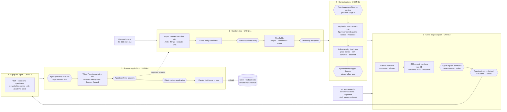

# Workflow: from upcoming renewal to bound policy

The one-page map for the deliverable is the diagram below; the tables underneath are the detail
for each stage. Guiding principle: **AI does the paperwork, people make the calls, and the
database, not the model, owns every number a client sees.**

UKON's brief has four stages; this splits its Stage 1 into **1 · Confirm data** and **2 · Get indications**,
so stages 3–5 here are UKON's 2–4 (decision #55).

Legend: rectangles = AI or system; hexagons = a human decision.

---

## Stage 0 · Spot the renewal

| | |
|---|---|
| **AI / system** | Pull renewals 60–120 days out from the agency management system (AMS); rank by fit (industry, size, data sensitivity) so the agent works the best opportunities first. |
| **Human** | Agent or account manager picks which to pursue; can snooze a client. |
| **What could go wrong** | Clients already have cyber (as a BOP endorsement or elsewhere) → wasted effort. **Catch:** check existing policies and endorsements in the AMS before queuing. *(Designed, not built.)* |

## Stage 1 · Confirm data (built; UKON Stage 1, part 1)

| Step | AI does | Human does | What could go wrong → how it's caught |
|---|---|---|---|
| Ingest | Reads the AMS row, state registry, NPI registry, website, directory listings, press releases and DNS records into the client wiki; extracts signals with a citation per value. | — | Prompt injection or junk in sources → sources are data, never instructions; every value cites its raw file. |
| Entity resolution | Scores candidates on name + state + address + domain together; a delinquent or dissolved entity's score is halved. | **Always confirms** the match. | Same name at the same address but delinquent → the real demo case ("Sloans Lake Dental PLLC", delinquent since 2022, vs Sage Dentistry, PLLC in good standing). |
| Domain, industry, address | Cross-checks independent sources; high confidence when they agree. | Only if flagged. | Wrong domain → wrong carrier scan → wrong price. Needs agreement across AMS email domain, website, and MX records. |
| Employees | Most recent direct count wins; range spans recent signals; stale signals ignored. With no published count, an explicit estimate (dentists × support-staff assumption), low confidence. | Reviews if signals disagree beyond ±20%, or if the count is estimated. | Headcount ≠ FTEs → stated as an assumption; confirmed on the call. |
| Revenue | Waterfall: agency record → public filing → two benchmark methods (staff × revenue/employee; dentists × billings/dentist). Range + confidence. | **Always reviews** estimated revenue. | Revenue isn't public for private SMBs → two independent methods must agree; flagged for confirmation before binding. |
| Exposure | Rough, explainable score: data sensitivity, email accounts, DMARC/SPF, online payments, record volume. | Adjusts with a slider. | Mistaken for a security rating → labeled "not a security scan"; controls unknown until the call. |

Review by exception: in the demo, 3 of ~8 items need a person (entity, revenue, plus anything with conflicting signals).

## Stage 2 · Get indications: the agent ↔ carrier exchange (built; UKON Stage 1, part 2)

An indication is a carrier's non-binding ballpark for a given limit and deductible. UKON's Stage 1 isn't done
until those come back, so the prototype gives the round trip its own stage, with a person's approval before
anything is sent. The app's Stage 2 screen sends (gated on Stage 1), reads replies in from the inbox, shows
every carrier's versions read-only, lets a person check a flagged figure, and closes follow-ups with a note.

| Step | AI does | Human does | What could go wrong → how it's caught |
|---|---|---|---|
| Request (outbound) | Sends the five fields to each carrier on the panel for two options: **$1M / $10K** and **$2M / $25K**. Stores the basis exactly as sent, with what was still unreviewed. | Sends (re-requests are gated: entity confirmed and flagged fields reviewed). | Wrong company or stale revenue priced → the basis snapshot shows what each carrier priced on; revenue drift beyond ±15% raises "re-request". |
| Reply arrives | Nothing: the reply is saved as received in `wiki/raw/<client>/indications/`, recording **how it came in**. PDF letters, emails and Wispr Flow captures of underwriter calls are saved as files and ingested. (Paste / API inputs were prototyped and removed.) | Saves the file. | Same reply twice → content hash recorded. |
| Extract | Reads the text (pypdf / pasted text), then an LLM pulls carrier, options, premiums, sublimits, conditions, expiry, with the line each came from. | — | Model invents or mis-reads a figure → next step. |
| Check | **Deterministic:** every money figure and the expiry date must appear in the source, written in full. Client name and carrier name must appear. | Confirms or rejects anything that fails (e.g. Cobalt's "5.29k"). | Shorthand, calculated dates, a reply for another client → flagged, never auto-accepted. |
| Version | Appends a version per carrier + option; nothing is overwritten. Diff vs the previous version (premium, limit, deductible, sublimits, conditions, expiry, verbal → written). | — | History lost → append-only table, values locked by a database trigger. |
| Act | Fixed rules turn the diff into actions: price changed (and whether a sent pack showed the old price), new condition (with the intake's answer), declined, verbal-only, figure to confirm. Alerts for expiring indications and revenue drift. | Works the list; closes each action with a note. | Agent misses a change → it stays in "Needs attention" until a person closes it. |
| Current state | The client pack reads only the latest **written**, **checked** version per carrier + option. | Picks the carrier to show (default rule: cheapest $1M with full-limit ransomware). | Verbal number reaches the client → impossible: verbal versions are excluded from the view. |

Demo: run_all loads four replies (Northwind PDF, Cobalt email, Ridgeline call then letter); the revised Northwind
letter waits in Stage 2's carrier inbox for a live "Read it in" (or the command line).

## Industry research (built)

| | |
|---|---|
| **AI does** | Searches the web for recent, real events in the client's industry (breaches, ransomware, vendor incidents, regulation) and writes cited items to `wiki/raw/research/` (`client-research` skill). |
| **Human does** | Reviews the items; deletes any that don't fit. Each item is tagged for the client pack, the agent brief, or both. |
| **What could go wrong** | Invented or stale events → every item needs a URL and date; figures are quoted from the source; the tailored line may not add numbers. |

## Stage 3 · Client proposal pack: the HTML report (built)

| Step | AI does | Human does | What could go wrong → how it's caught |
|---|---|---|---|
| Draft | Writes the "why it matters" text, three industry scenarios, exposure explainer, next steps, using placeholders for any count. | — | AI invents a figure → **any digit in AI prose fails validation**; figures are filled from the DB. |
| Numbers | — (rendered from DB: premiums, limits, deductibles, sublimits, benchmark costs) | — | Hallucinated price → impossible; no code path from model to price. |
| Coverage text | — (from a CPL-approved plain-language library) | — | Overstating coverage → library text only; funds-transfer sublimit is flagged visually. |
| Adjust | Shows its recommendation next to the current value. | Moves revenue, employees, exposure, records, carrier; adds a reason. | Revenue moves far from what carriers priced on → "indication needs refresh" banner; premiums are not recalculated. |
| Lock & send | — | Submits (version locked), then sends. Any later change creates a new version. | Client sees an unreviewed draft → client view only shows submitted versions. |

## Stage 4 · Equip the agent: the brief (built)

| Step | AI does | Human does | What could go wrong → how it's caught |
|---|---|---|---|
| Brief | Tailors a 60-second pitch; selects and tailors objection answers from the **CPL-approved library**; maps where key items live in the specimen form. | Reads it before the meeting. | AI invents an objection answer → library-only; tailoring can't add claims. Specimen references must resolve to real text on the cited page, or they're dropped (production rule). |
| Ask about this client | Answers from DB (numbers) + wiki (reasons), cited; read-only. | Asks questions. | Coverage interpretation → **escalates to CPL**. Agent wants to change a value → told to use the slider so it's logged. |
| Debrief *(designed)* | Ingests meeting notes and new objections into client + industry pages. | Logs outcome. | New objections bypass review → go to CPLs before entering the library. |

## Stage 5 · Present and ask: the call, human in the loop (built)

The agent presents the pack on a call and asks what the carrier application needs, in plain language. These
questions used to come before the pack; they moved here because asking about security practices before the owner
has seen a price adds friction. (The demo seed runs call 1 early so the pack shows answers so far.)

| Step | AI does | Human does | What could go wrong → how it's caught |
|---|---|---|---|
| Question list | Plain-language questions from the carrier question bank, minus what the wiki/DB already knows. | — | Jargon → plain wording ("a code from your phone" for MFA). |
| Call(s) | — | Agent runs one or more calls from **Stage 5 → Live call**: reads the numbered questions, taps answers, marks "client unsure," logs coverage questions for a CPL, reads the limit walkthrough. Each call opens with recording consent; Wispr Flow captures it. | No consent → transcript not used. Agent answers a coverage question → script says escalate; it's logged. |
| Extract & merge | Pulls intake + application answers with quote + timestamp per call; checks them against the live taps; merges with earlier calls. | — | "Mostly" → **hedge check forces follow-up**. Recording ≠ tap → **CONFLICT** flagged. A later call contradicts a confirmed answer → reopened, never silently overwritten. Re-ingesting an older call never overwrites a newer one. |
| Proceed incomplete | Exposure score recalculated from controls confirmed so far. | Agent decides it's enough to build the pack. | Owner thinks the gaps block a price → pack lists them as "to confirm" and says they don't hold anything up. |
| Confirm | — | Agent confirms in **Stage 5 → After the call**; that also confirms the application questions the answer fills; confirmed revenue/records update the report as logged changes. | Wrong answer reaches the application → agent review now, client signature later. |

Demo: call 1 leaves three items open (MFA for hygienists, backups, EDR); call 2 closes two of
them and exposure drops from 63 to 45. Backups stay open, and the pack still goes out.

## Stage 5 · Apply and bind (application built; carrier submission and binding simulated)

| Step | AI does | Human does | What could go wrong → how it's caught |
|---|---|---|---|
| Close gaps | — | Agent closes items still "to confirm" (another short call, or the owner answers by link). | Binding on an open answer → e-sign button stays disabled until every answer is confirmed. |
| Sign & bind | — | **Client reviews and e-signs** the pre-filled application; carrier confirms final terms; bind. | Misrepresentation voids a claim → the client signs; the transcript is never the final word. |

Option for lower-touch clients *(designed)*: the same plain-language questions as a link the
owner answers on their phone, with the call as the default for relationship clients.
